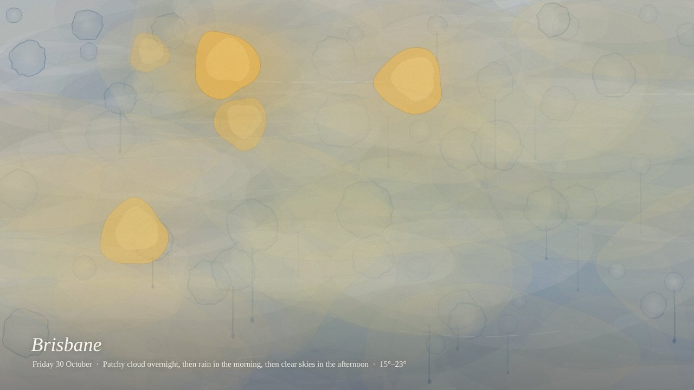
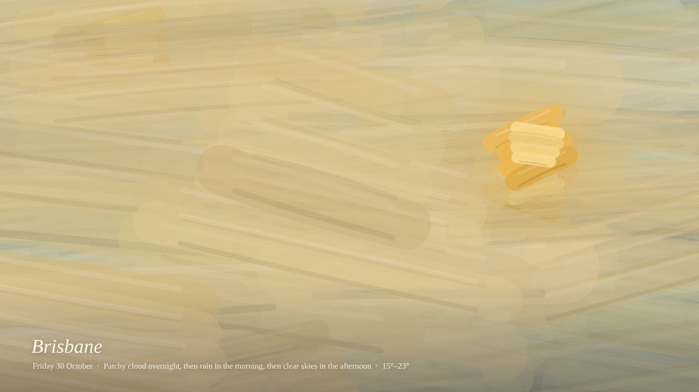
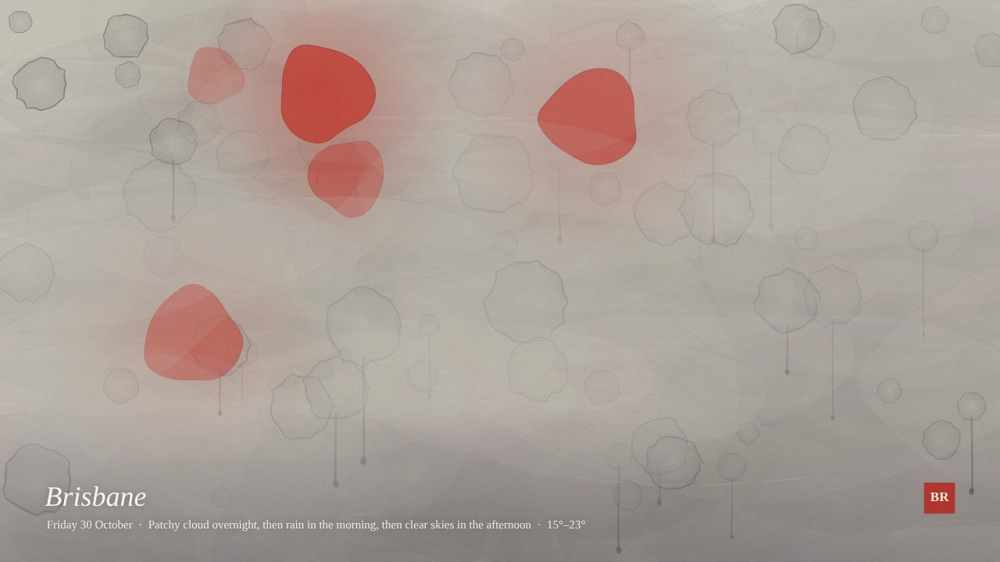
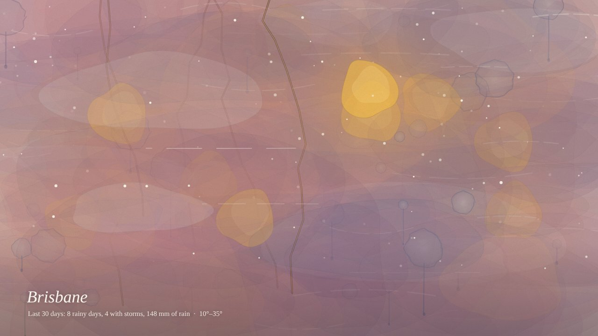
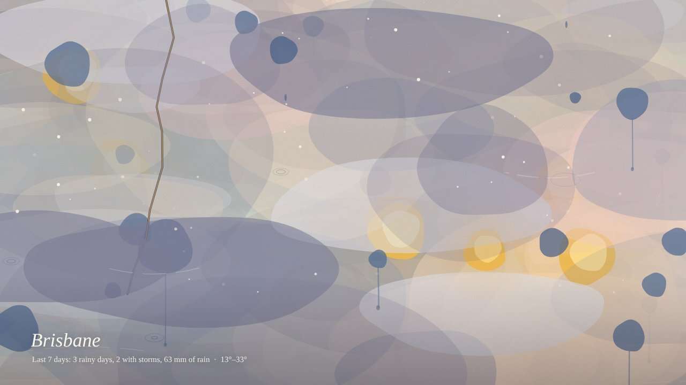
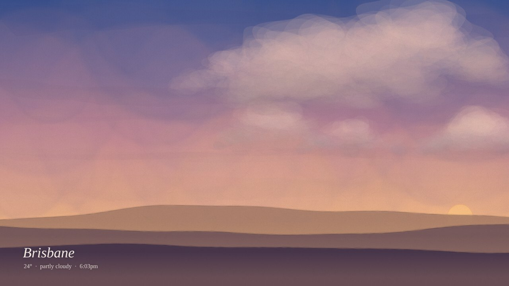

# Weatherglaze 🎨

**Your weather, painted hour by hour.**

Weatherglaze turns real weather into an abstract painting. Every hour of weather becomes one layer of paint over the whole canvas, so the painting builds up through the day:
- Rain leaves blooms and drips.
- Sunny hours add gold.
- Wind drags dry-brush strokes across the canvas.
- Night deepens everything to indigo.

Save it as a seamless looping wallpaper.

**▶ Try it: `https://arnikadb.github.io/weatherglaze`**



| | |
|---|---|
|  |  |
|  |  |

## How the weather becomes paint

| Weather | Paint |
|---|---|
| Temperature | The colour of each hour's layer (cool blues to warm apricot) |
| Rain | Watercolour blooms with dark rims, drips, and falling drops that splash |
| Sun | Gold blooms, stronger when the sky is clear |
| Cloud | Pale grey glazes, and it greys out the colour underneath |
| Wind | Dry-brush strokes that drift in the wind's direction |
| Night | Indigo washes, with white specks on clear nights |
| Storms | A lightning stroke in ink and gold |
| Snow | White gouache dots |

Each layer has its own seed, so when a new hour arrives it's painted on top and the earlier layers stay exactly where they were.

## Customise

- **Timeframe:** today, 3 days, a week or a month. Longer ranges stack more layers.
- **Medium:** watercolour, gouache, oil or ink.
- **Palette:** temperature, pastel, moody or sunset.
- **Splotch size**
- **Layer strength** for colour, rain, sun, cloud and wind. Set one to zero to remove it.
- **Caption:** show or hide the place and weather summary.

Settings are remembered, and **Copy link** shares the exact painting.

There's also a **Landscape** mode that paints the sky as it looks right now (sun and moon position, clouds, rain), in watercolour, ink or pixel styles.



## Save it as a wallpaper

Click **Save this sky**:
- **Animated WebP:** best quality.
- **Animated GIF:** works everywhere.
- **PNG:** a still.

Sizes include HD, QHD, square, phone, or your screen. Every animation repeats exactly, so the loop has no visible seam.

**Opera:** drag the WebP into a tab, right-click it and choose *Use image as wallpaper*.

## Demo data

Add `?demo=` with `rain`, `storm`, `noon`, `grey`, `snow` or `night` to paint example weather without fetching anything. It works with every option, e.g. `?demo=storm&range=7&medium=oil`.

## Run locally

Plain HTML and JavaScript, no build step. ES modules need a local server:

```bash
python3 -m http.server
# open http://localhost:8000/?demo=rain
```

## Deploy on GitHub Pages

Repo **Settings → Pages → Deploy from a branch → `main` / root**.

## Code

```
index.html        UI, location search, customise panel, export dialog
src/abstract.js   hourly weather → layered abstract painting
src/sky.js        current weather → landscape painting
src/export.js     GIF encoder + animated WebP muxer
vendor/gifenc     GIF encoding (MIT, Matt DesLauriers)
```

- **Abstract mode:** `buildAbstract()` paints all the static layers once, to an offscreen canvas. `paintAbstract()` then draws the moving parts (falling drops, wind, twinkling stars) on top each frame.
- **Seamless loops:** all motion is a function of loop progress `p` from 0 to 1, which is why exports loop cleanly.
- **Animated WebP:** the browser encodes each frame as a still WebP, and `export.js` wraps the frames into an animated WebP file without any library.

## Credits

- Weather, history and geocoding: [Open-Meteo](https://open-meteo.com) (free, no API key, CC BY 4.0)
- Place names for "my location": [BigDataCloud](https://www.bigdatacloud.com) free client API
- GIF encoding: [gifenc](https://github.com/mattdesl/gifenc) (MIT)

## License

MIT
