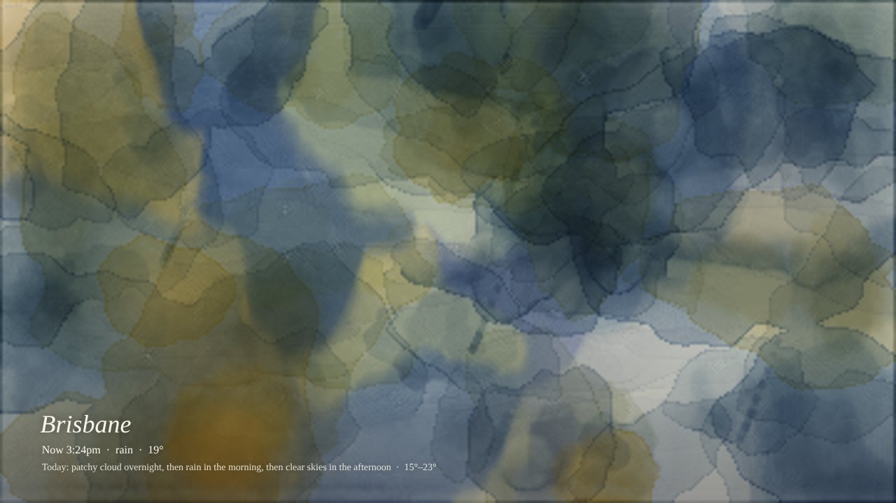
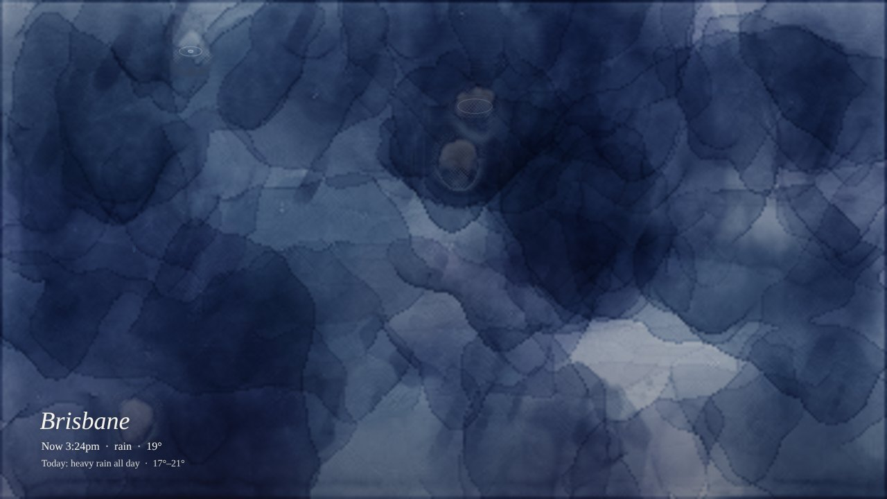
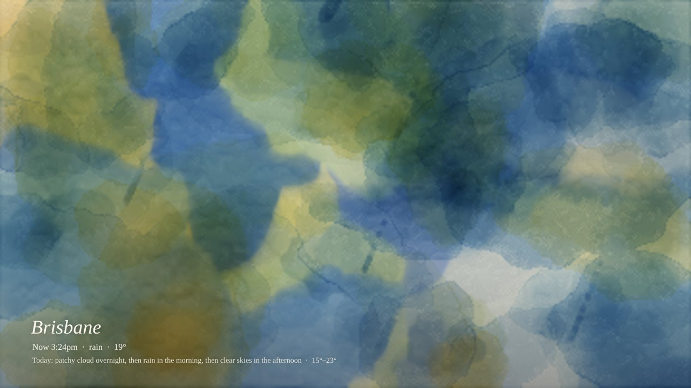
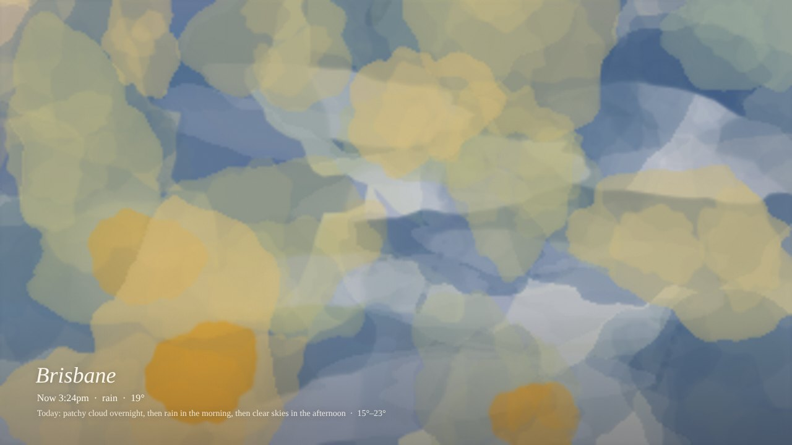
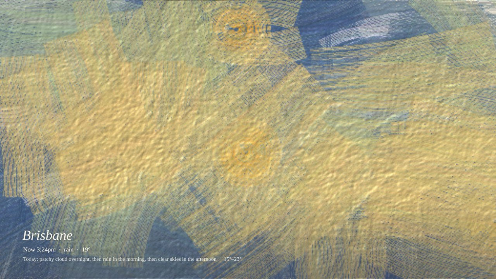

# Weatherglaze 🎨

**Your weather, painted hour by hour.**

Weatherglaze turns live weather into a painting made with a real paint simulation. Every hour of weather is one wet layer of paint over the whole canvas:
- the colours bleed into each other while they're wet,
- they dry with darkened edges,
- they granulate into the paper's texture,
- and the layers stack up as glazes through the day.

Rain falling into a damp wash pushes the pigment out into blooms, and heavy rain runs down the page.

Everyone's painting is their own. The weather decides the colours, so a downpour is deep blue for everybody. Each visitor gets a personal seed that decides everything else: where the paint lands, the shapes, their orientation, how the paint flows, and the paper itself. Two people looking at the same day, or one person looking at two days with the same weather, get different paintings.

**▶ Try it: `https://arnikadb.github.io/weatherglaze`**



| | |
|---|---|
|  |  |
|  |  |

## How the weather becomes paint

| Weather | What happens on the paper |
|---|---|
| Temperature | Sets each hour's colour, from cool blues to warm apricot |
| Rain | Clean water drops into the damp wash and pushes the pigment into blooms. Heavier rain means more water, so the paint runs downwards |
| Sun | Earlier paint is lifted back towards the paper, and a gold glaze bleeds into it |
| Cloud | Pale grey glazes that soften the colours |
| Wind | Drags the wet paint downwind, and leaves dry-brush strokes that catch the paper's texture |
| Night | Indigo washes, with specks of white gouache on clear nights |
| Storms | A lightning stroke scratched back to the paper |
| Snow | Salt-like specks where water pushes the pigment aside |

Before the first hour, the whole sheet gets a ground wash in the day's colours, so there's never bare white paper. Each hour is painted on top of the last, and earlier hours never move.

### The simulation

The water-based media (watercolour, ink and gouache) use a simplified version of [Curtis et al., *Computer-Generated Watercolor* (1997)](https://grail.cs.washington.edu/projects/watercolor/):

- Water flows between neighbouring cells of a paper grid, downhill over the paper's fibres and dips.
- Pigment floats in the water and travels with it, which is why wet colours bleed together.
- The edge of a wet patch stays put while it dries, so water keeps flowing out to it and leaves pigment behind. That's where the darker edges come from (the "coffee ring" effect).
- Pigment settles faster in the paper's valleys, which gives granulation.
- Dried layers are glazed on with Beer–Lambert absorption, which makes them transparent and lets colours mix subtractively. Gouache also covers what's underneath.

The simulation runs on the GPU with WebGL2, so a whole day paints in about a second. Older devices fall back to a CPU version.

**Oil** uses a different model with no water. A bristle brush picks up wet paint already on the canvas, mixes it with what it's carrying, and runs dry along the stroke. The paint builds up a height map, which is then lit to show the impasto.

| Medium | Character |
|---|---|
| Watercolour | Fluid and transparent: blooms, dark edges, granulation, runs |
| Ink | Very fluid and saturated. It stains quickly and feathers along the paper fibres |
| Gouache | Thick and opaque. It bleeds gently and covers the layers below |
| Oil | Brushstrokes that blend wet-on-wet, with raised, lit texture |

## Customise

- **Timeframe:** today, 3 days, a week or a month. Longer ranges stack more layers.
- **Medium:** watercolour, ink, gouache or oil.
- **Palette:** temperature, pastel, moody or sunset.
- **Splotch size**
- **Layer strength** for colour, rain, sun, cloud and wind. Set one to zero to remove it.
- **Caption:** shows the current conditions and a summary of the day, or hide it.
- **Repaint (🔄):** a new composition from the same weather.

Your settings and your seed are saved in your browser. **Copy link** includes both, so whoever you send it to sees exactly your painting.

There's also a **Landscape** mode that paints the sky as it looks right now (sun and moon position, clouds, rain), in watercolour or pixel style.

## Live weather

When the page loads, it fetches the current conditions and every hour so far from [Open-Meteo](https://open-meteo.com), and it refreshes every 15 minutes. The status line in the top corner shows whether you're seeing live data (with the local time) or demo weather.

## Save it as a wallpaper

Click **Save this sky**:
- **Animated WebP:** best quality.
- **Animated GIF:** works everywhere.
- **PNG:** a still.

Sizes include HD, QHD, square, phone, or your screen. Every animation (falling drops, ripples, blooms) repeats exactly, so the loop has no visible seam.

**Opera:** drag the WebP into a tab, right-click it and choose *Use image as wallpaper*.

## Demo data

Add `?demo=` with `rain`, `downpour`, `storm`, `noon`, `grey`, `snow` or `night` to paint example weather without fetching anything, e.g. `?demo=downpour&medium=ink`.

## Run locally

Plain HTML and JavaScript, no build step. ES modules need a local server:

```bash
python3 -m http.server
# open http://localhost:8000/?demo=rain
```

## Code

```
index.html          UI, location search, customise panel, export dialog
src/abstract.js     weather → layers of marks, ground wash, animated drops
src/paint-sim.js    paper, water/pigment simulation (CPU), oil bristle model
src/gpu-sim.js      the same water/pigment simulation as WebGL2 shaders
src/sky.js          landscape mode
src/export.js       GIF encoder + animated WebP muxer
vendor/gifenc       GIF encoding (MIT, Matt DesLauriers)
```

## Credits

- Weather, history and geocoding: [Open-Meteo](https://open-meteo.com) (free, no API key, CC BY 4.0)
- Place names for "my location": [BigDataCloud](https://www.bigdatacloud.com) free client API
- Watercolour model after Curtis, Anderson, Seims, Fleischer & Salesin, *Computer-Generated Watercolor*, SIGGRAPH 1997
- GIF encoding: [gifenc](https://github.com/mattdesl/gifenc) (MIT)

## License

MIT
